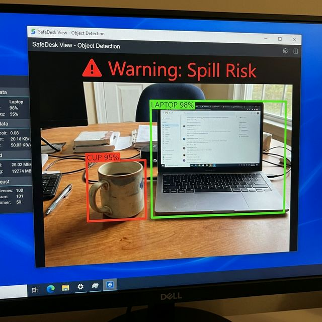

# ESUA: Environment Spatial Understanding Assistant

[](https://github.com/likhith1253/ESUA/actions/workflows/ci.yml)

ESUA goes one step past object detection: it takes what YOLOv8 sees in a webcam frame, works out how the objects are arranged, and warns about simple hazards such as a cup of liquid sitting next to a laptop. It was built in phases (detection, spatial relations, context rules, explanations, camera integration), and every phase is kept as a runnable script.

## Problem

Plain detectors answer "what is in the picture". A useful safety assistant also needs "what is next to what, and does that matter". ESUA adds a small, transparent rule layer on top of a detector so that every warning can be traced to a rule and a measured pixel distance.

## What is implemented

| Phase | Script | What it does |
|---|---|---|
| 1 | `ESUA/phase1_object_detection/detect_image.py` | YOLOv8n detection on an image, draws boxes |
| 2 | `ESUA/phase2_spatial_understanding/spatial_relations.py` | Box centres, pixel distance, near/far, left/right, box overlap |
| 3 | `ESUA/phase3_context_reasoning/context_reasoning.py` | Maps COCO classes to categories (liquid, electronics, flammable, ...) and applies risk rules |
| 4 | `ESUA/phase4_explanation_generation/explanation_generator.py` | Turns a detected risk into a four-line plain-language explanation |
| 6 | `ESUA/phase6_camera_integration/snapshot_analyzer.py` | Webcam ring buffer of 5 frames; press `c` to analyse. Class-aware confidence thresholds, objects must appear in at least 2 of the 5 frames, then spatial + risk analysis |
| 6 | `ESUA/phase6_camera_integration/camera_runner.py` | Continuous live mode (inference every 5th frame) |

The shared logic is in the `esua_core/` package (categories, spatial geometry, risk rules, explanation templates, temporal aggregation). It has no OpenCV, torch or webcam dependency, which is what the unit tests exercise.

Current rules (see `esua_core/risk_rules.py`): liquid near electronics gives a spill risk; liquid near flammable items (book, paper, cardboard box) gives a damage risk. "Near" means the box centres are less than 400 px apart, a 2D image heuristic and not a real-world distance.

## How to run

```bash
git clone https://github.com/likhith1253/ESUA.git
cd ESUA
python -m venv .venv && .venv\Scripts\activate      # source .venv/bin/activate on macOS/Linux
pip install -r requirements.txt                      # ultralytics (pulls PyTorch), opencv-python, numpy

# analyse a still image (no webcam needed)
python ESUA/phase3_context_reasoning/context_reasoning.py
python ESUA/phase4_explanation_generation/explanation_generator.py

# webcam: press c to capture and analyse, q to quit
python ESUA/phase6_camera_integration/snapshot_analyzer.py
```

`yolov8n.pt` is downloaded automatically by Ultralytics on the first run (it is not tracked in git). Run the scripts from the repository root.

`examples/blip_caption_demo.py` is an unrelated image-captioning experiment (BLIP) that was in this repository's first commit; it has its own `examples/requirements.txt`.

## Results (what was actually measured)

There is no labelled evaluation set in this repository, so no accuracy, precision or recall figures are claimed. What was run:

* **Phase 3 on the bundled `sample.jpg`** (YOLOv8n, CPU): detected 1 cup, 1 apple, 1 chair, 2 potted plants, 1 dining table and 1 book in about 0.27 s per image, and reported `Damage Risk detected: cup (liquid) is near book`.
* **Phase 6 `snapshot_analyzer.py` with a simulated camera** (the same image fed as 5 identical frames, since no webcam was attached): all 7 objects were confirmed in 5/5 frames, and it produced the same cup-near-book damage-risk explanation.
* **Unit tests** (`python -m pytest tests`): 26 tests pass (2 skipped placeholders): categories, geometry, risk rules, explanations, temporal aggregation, and a compile check of every script, all without a camera or model.




## Limitations

* Distances are in image pixels, so "near" depends on camera distance and resolution; there is no depth estimate.
* Only two risk rules exist (the `fire_risk` and `sharp_risk` explanation templates are defined but no rule triggers them yet), and categories are a hand-written COCO lookup.
* Detection quality is whatever YOLOv8n gives on a CPU-friendly 640 px input; small objects such as cups are detected with a deliberately low confidence threshold (0.10), which trades false positives for recall. The multi-frame confirmation reduces but does not remove spurious objects.
* The webcam modes were run here only with a simulated camera, not against real hardware.
* `phase1_object_detection/detect_image.py` and the camera scripts open OpenCV windows, so they need a desktop session and `opencv-python` (not the headless build).

## Repository layout

```
esua_core/     pure-Python logic (categories, spatial, risk_rules, explanations, aggregation)
ESUA/          phase scripts and their sample images
tests/         unit tests (no webcam or weights needed)
docs/          architecture, data flow, features, setup, deployment, images
examples/      unrelated BLIP captioning demo
```

Further reading: [architecture](docs/architecture.md), [setup](docs/setup.md), [how to run](docs/how_to_run.md), [features](docs/features.md), [data flow](docs/data_flow.md), [use cases](docs/use_cases.md).

## Roadmap

Depth cameras for true 3D distance, user-defined rules in a config file, audio alerts, and edge-device deployment are ideas, not implemented features.

## License

MIT, see [LICENSE](LICENSE).

Author: Likhith Ponnada
